# Stubble Fire Watch

**Crop-residue fires and smoke over Punjab, Haryana and the Indo-Gangetic Plain, 2003 to today.**

A live map, a twenty-year analysis and an open dataset built from NASA, ICAR-IARI, CPCB and government records:
every satellite fire detection since 2003, the burn scars NASA maps from orbit, a smoke field that animates the
haze as it drifts over Delhi, official burning counts parsed from 851 daily bulletins, Delhi's measured air,
paddy area by district, and what Punjab and Haryana did about it.

**Live:** [fire.reclaimchennai.city](https://fire.reclaimchennai.city) · **Analysis:** [fire.reclaimchennai.city/db](https://fire.reclaimchennai.city/db/) ·
**North to south:** [fire.reclaimchennai.city/south](https://fire.reclaimchennai.city/south/) ·
**Data:** [`datasets/`](datasets/) and the [latest release](../../releases/latest) · **Method:** [`docs/METHODS.md`](docs/METHODS.md)

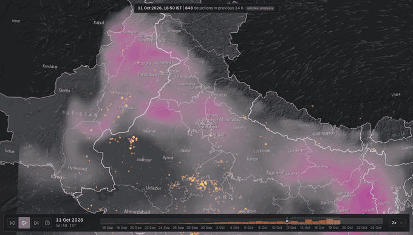

The map shows the smoke field from NASA's GEOS-FP model (organic, black and brown carbon aerosol at 550 nm) moving
with the 10 m wind, and every fire detected by NASA's MODIS and VIIRS satellites in the previous 24 hours, fading
as it ages. It refreshes itself: new satellite passes arrive within about three hours of the overpass and the page
follows the latest one.

---

## What the data says

| | |
|---|---|
| **The fire count collapsed.** | VIIRS detected **87,883** fires in Punjab's 2016 paddy season and **4,235** in 2025 (−95%). ICAR-IARI's official count fell from **1,02,379** to **5,114**. Haryana fell from 13,097 to 1,091. |
| **The paddy did not.** | Punjab's kharif rice area grew from 2.90 million ha (2016) to 3.27 million ha (2025). The straw is still there. |
| **The burned ground fell less.** | NASA's burned-area product (MODIS MCD64A1) puts Punjab's burned area at **1.89 million ha** in 2016 (65% of the rice area) and **0.63 million ha** in 2024 (20%): a fall of 67%, against 90% for fire detections. |
| **More of it burns unseen.** | Fire detections per 1,000 ha burned fell from **46** to **14** in Punjab. The share of VIIRS detections caught on the 01:30 IST night pass rose from **1.8%** (2012) to **8.7%** (2025). Burning has moved towards the hours between satellite passes. |
| **Across the border, nothing changed.** | Pakistani Punjab, the same plain and the same crop, had **13,674** VIIRS detections in 2025: 3.2 times Indian Punjab. |
| **Delhi still chokes.** | November mean PM2.5 at Delhi's CPCB monitors: 292 µg/m³ (2016), 242 (2021), 219 (2025). IITM's model put stubble burning's share of Delhi PM2.5 at up to 35% on the worst days of 2023 and 2024, and 22% in 2025. |
| **Enforcement arrived late.** | Punjab imposed ₹1.26 crore in environmental compensation and registered 1,963 FIRs and 2,176 red entries in land records in 2025, against fires it had once counted in the lakhs. |

All figures are computed from the datasets in this repository; the analysis page draws them as charts.

### North to south: does the smoke reach Chennai?

Since October 2026 the fire map and the smoke field cover all of India and the Bay of Bengal, and a third page,
[`/south`](https://fire.reclaimchennai.city/south/), asks whether north Indian farm fires foul the air 2,000 km
away in Chennai. Every day of every October-December since 2018, four five-day back-trajectories are run from
Chennai and eight other cities through NASA GEOS-FP 850 hPa winds, and each is scored by the fires it crossed.

| | |
|---|---|
| **Rarely.** | On **10.5%** of October-November days (54 of 515, 2018-2026) the air arriving over Chennai had crossed Punjab, Haryana or Delhi while fields there were burning. Kolkata: 28%, Visakhapatnam: 21%, Bengaluru: 9%, Delhi: 99%. |
| **But it shows when it does.** | Holding rain, wind, mixing height, sea exposure and month fixed, a tenfold rise in the north-western fires the air met goes with **+25%** PM2.5 at Chennai's monitors (95% interval +9 to +43%). Over a season that is about 3% of Chennai's PM2.5; on the days the smoke arrives, up to a third. |
| **The plain's air is dirty anyway.** | On dry October days Chennai reads a median **49 µg/m³** when the air met the north-western fires, **51** when it came over the Gangetic plain but missed them, and **24** when it came off the Bay of Bengal. |
| **Cyclones matter more.** | Across 37 storms that passed within 800 km since 2016, Chennai's PM2.5 ran about **23% higher** for days after a storm passing to its north (land air pulled down from the north), and about **35% lower** after one passing to its south (rain and sea air). |
| **Arnab, October 2026.** | The very severe cyclonic storm passed 409 km NNE of Chennai on 27 October. On 26-27 October the city's air came down the east coast from the Gangetic plain, crossing about 245 fire detections in central and eastern India, and Chennai's sensor network rose from a median 20 to a peak of **151 µg/m³**. |

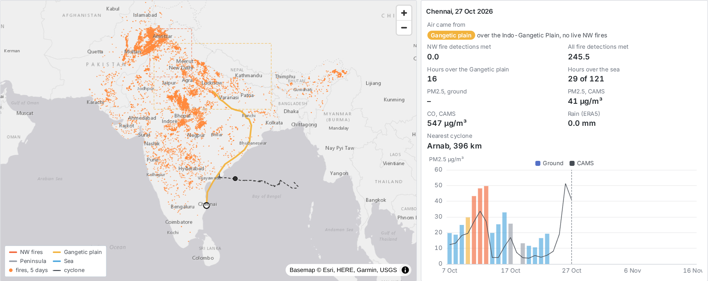

| | |
|---|---|
| 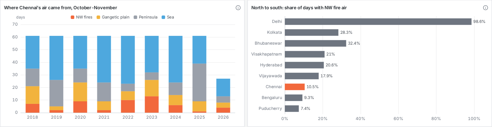 | 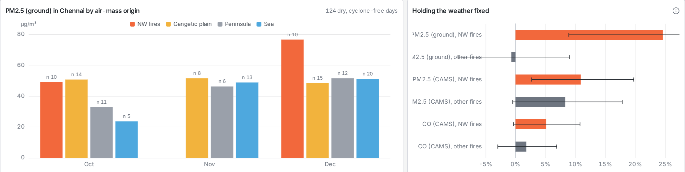 |
| 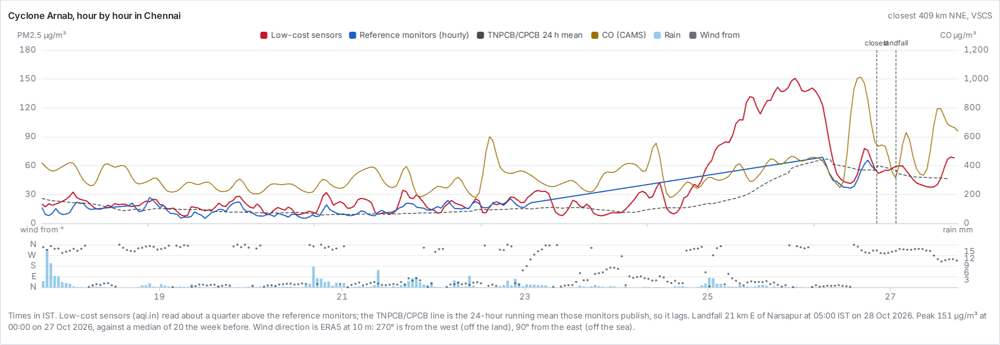 | 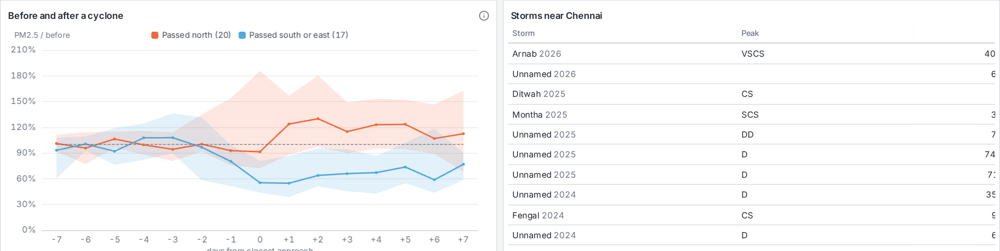 |

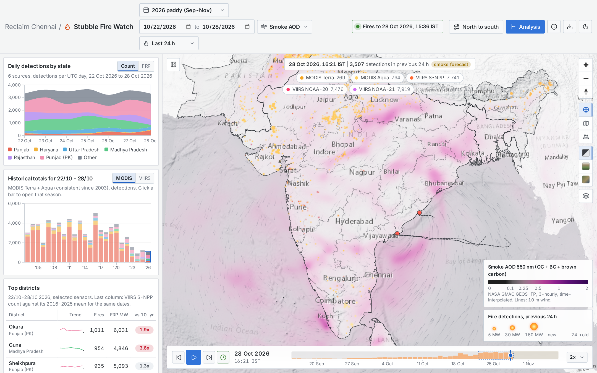

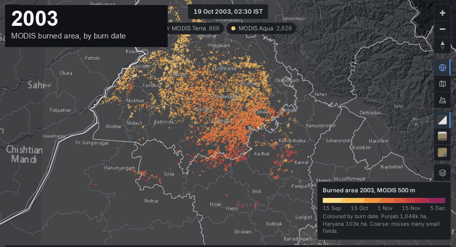

*MODIS burned area for every paddy season, 2003-2025, coloured by the date each 500 m pixel burned: pale yellow in
mid-September, orange-red in early November, purple in December. Majha (Amritsar, Tarn Taran) burns first; the
Malwa cotton-paddy belt (Bathinda, Sangrur, Muktsar) burns last.*

---

## The dashboard

| | |
|---|---|
| 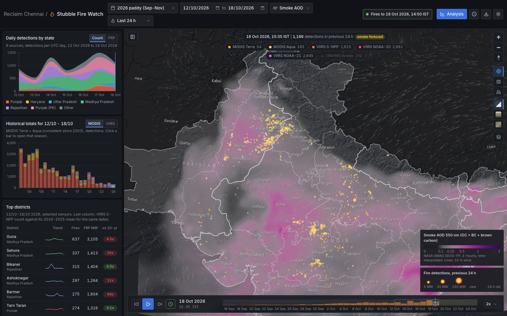 | 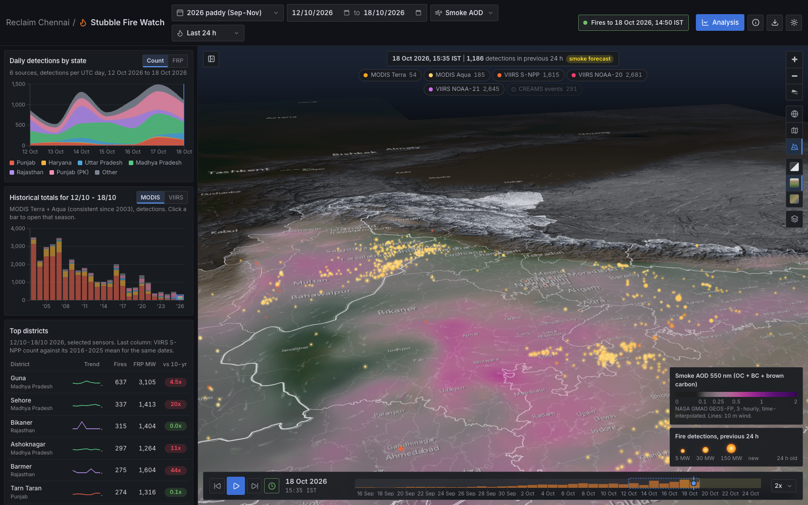 |
| **Live map.** Globe view, the GEOS-FP smoke field with wind lines, the last 24 h of fire detections, daily totals by state, same-dates totals for every season since 2003, top districts against their ten-year average. | **3D terrain.** AWS terrain tiles, exaggerated 4.5×, looking north across the plains at the Himalaya that traps the smoke. The relief basemap tints land below 300 m so the basin reads as one. |
| 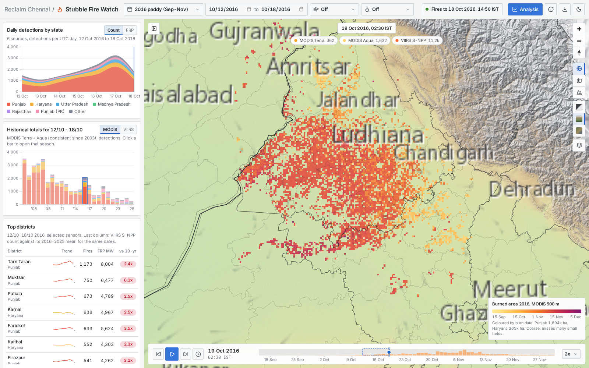 | 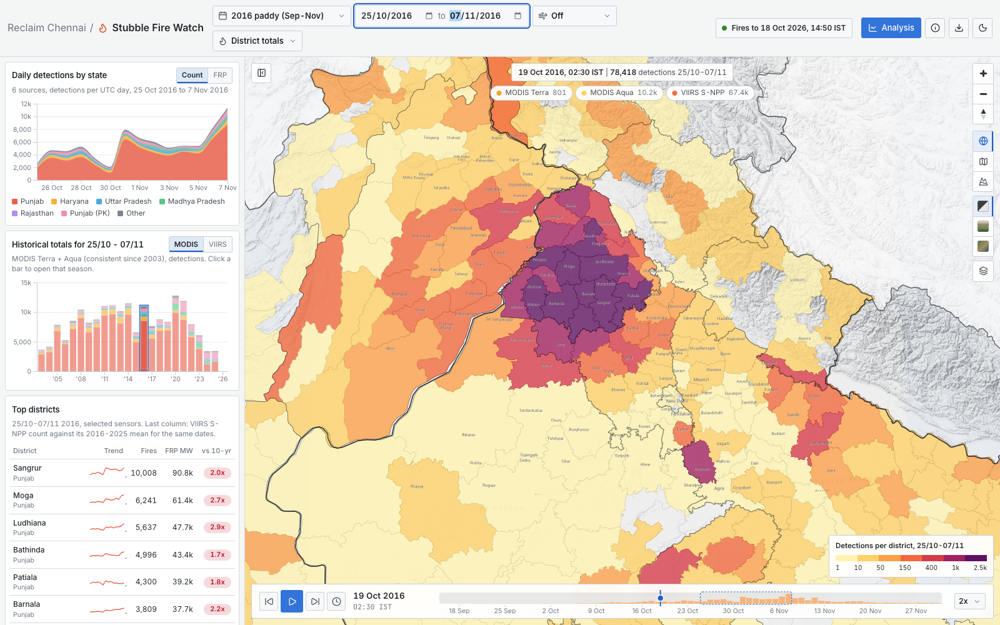 |
| **Burn scars.** MODIS burned area for the selected season, coloured by burn date. | **District totals and density** for any period, in light or dark theme. |

The [analysis page](https://fire.reclaimchennai.city/db/) has the long view:

| | |
|---|---|
| 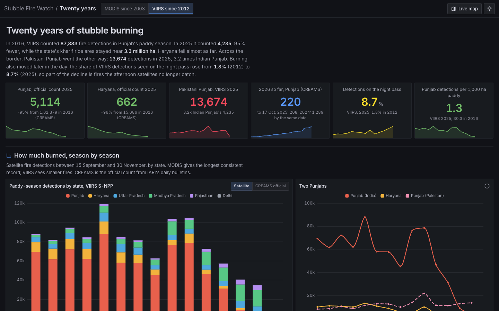 | 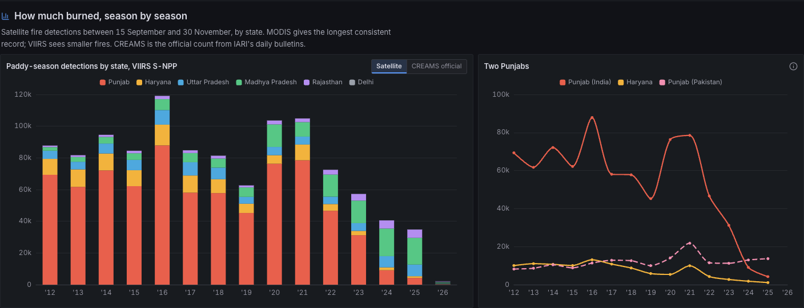 |
| 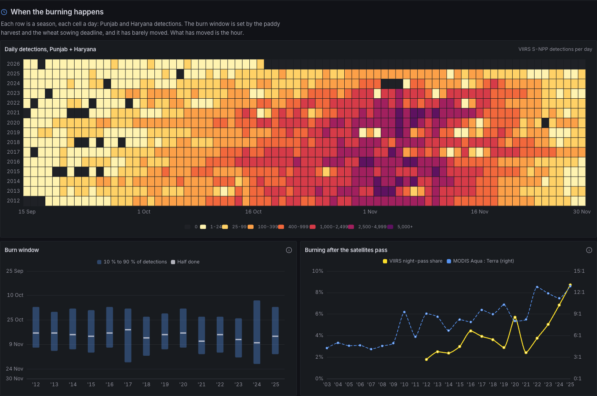 | 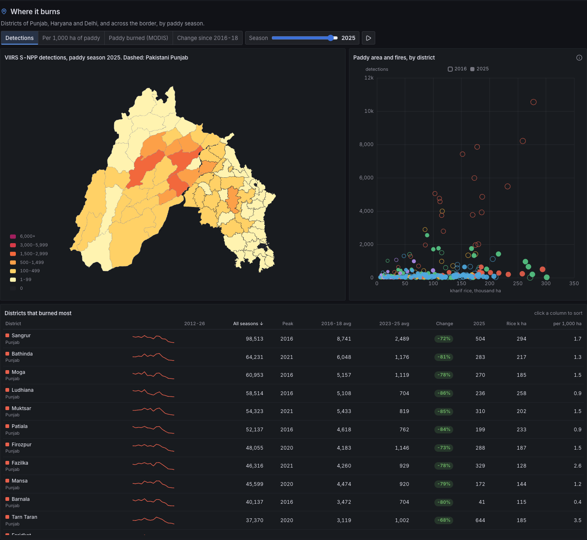 |
| 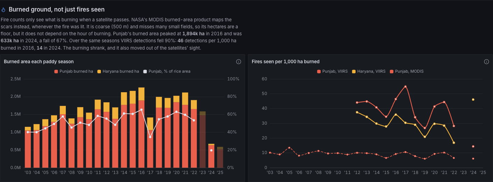 | 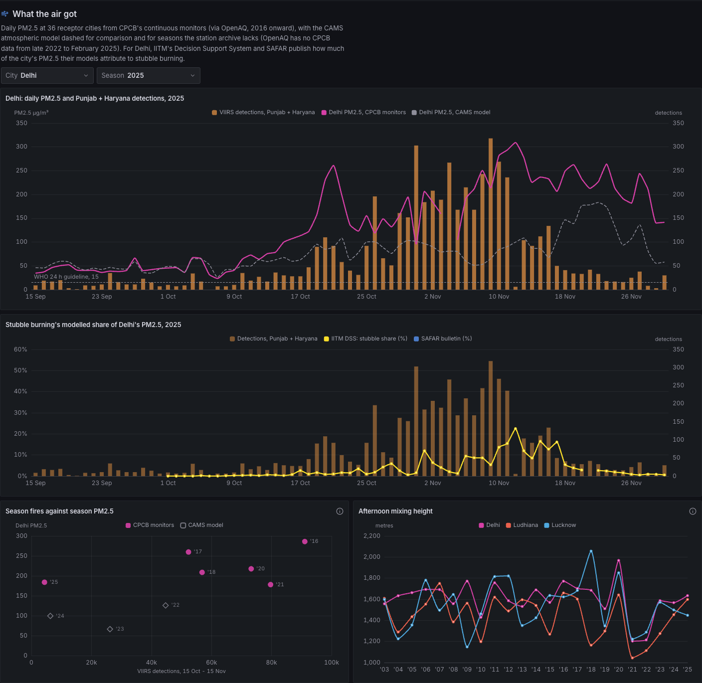 |

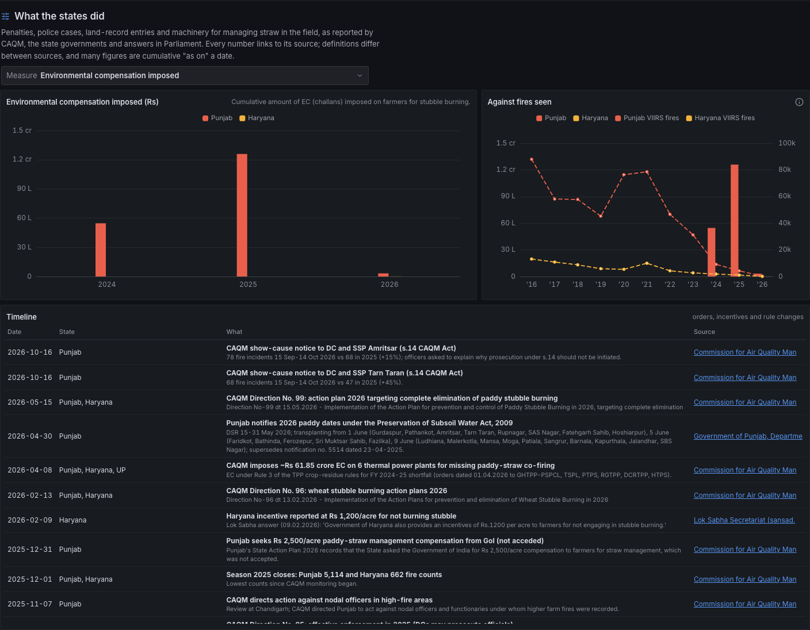

---

## Data

Everything the dashboard shows is published here in open formats. Small and medium tables live in
[`datasets/`](datasets/) (CSV, Parquet, GeoJSON, GeoPackage); the large files are attached to each
[GitHub release](../../releases/latest). Every folder has a README with column definitions, units, coverage,
sources and caveats. The full list is in [`DATA_DICTIONARY.md`](DATA_DICTIONARY.md).

| Dataset | Coverage | Formats | Where |
|---|---|---|---|
| **Fire detections**: every MODIS and VIIRS (S-NPP, NOAA-20, NOAA-21) detection over India and Pakistan (66-98 E, 6-37.5 N; releases before v2026.10.29 cover only 68.5-89 E, 21-35.5 N), with district and state | 2003 to today, 17.7 million rows | GeoParquet per year, CSV | release |
| Fire counts and radiative power by state, sensor and day; by district and season; by hour | 2003 to today | CSV, Parquet | [`datasets/fires`](datasets/fires) |
| **ICAR-IARI CREAMS** official counts, parsed from 851 daily bulletins: state and district daily series, multi-year comparison tables | 2016 to today | CSV | [`datasets/creams`](datasets/creams) |
| CREAMS geolocated residue-burning events from the bulletin annexures | 2018 onward, 698,696 events | GeoParquet, CSV | release |
| **Burned area** (MODIS MCD64A1, 500 m): state and district hectares, area by burn date | 2003 to 2025 | CSV | [`datasets/burned_area`](datasets/burned_area) |
| Burned-area rasters, burn date per pixel | 2003 to 2025 | Cloud-optimised GeoTIFF | release |
| **Smoke**: GEOS-FP organic + black + brown carbon AOD, total AOD and 10 m wind, 3-hourly | current season | NetCDF (CF) | release |
| **Ground PM2.5**: CPCB continuous monitors, 36 cities (40 stations in Delhi) | 2016 onward | CSV | [`datasets/air`](datasets/air) |
| Modelled PM2.5 (CAMS) and meteorology (ERA5: wind, boundary-layer height, rain) for 7 cities | 2003 onward (CAMS from Aug 2022) | CSV | [`datasets/air`](datasets/air) |
| **Stubble share of Delhi PM2.5**: IITM DSS daily (2023+) and SAFAR bulletins (2019-22) | as archived | CSV | [`datasets/air`](datasets/air) |
| **Paddy**: kharif rice area and production by district and state | 1997 to 2025 | CSV | [`datasets/paddy`](datasets/paddy) |
| **Enforcement and residue management**: compensation imposed and recovered, FIRs, red entries, inspections, action against officials, CRM machines, custom hiring centres, funds; policy timeline with sources | 2016 to 2026 | CSV, Markdown | [`datasets/enforcement`](datasets/enforcement) |
| Boundaries: districts, states, subcontinent outline (India's official view) | | GeoJSON, GeoPackage | [`datasets/boundaries`](datasets/boundaries) |
| **North to south**: daily air quality and weather at Chennai and 8 receptor cities (CPCB/TNPCB via OpenAQ, CAMS, ERA5), Chennai hourly reference monitors, 5-day back-trajectory fire exposure per city and day, Chennai trajectory paths, 247 Bay of Bengal / Arabian Sea cyclones with tracks | 2016 onward (trajectories 2018 onward, cyclones 2003 onward) | CSV, GeoJSON | [`datasets/south`](datasets/south) |
| **Dashboard bundle**: everything the web app loads, ready to serve | | ZIP | release |

```python
import pandas as pd
fires = pd.read_parquet("fire_detections_2021.parquet")          # from the release
season = pd.read_csv("datasets/fires/season_totals.csv")
season.query("state == 'Punjab' and season == 'rice' and sensor == 'VIIRS S-NPP'")
```

### Sources

| Source | What | Access | Licence / terms |
|---|---|---|---|
| [NASA FIRMS](https://firms.modaps.eosdis.nasa.gov/) | MODIS C6.1, VIIRS 375 m active fires | yearly country files; area API (free MAP_KEY) | NASA open data |
| [NASA MCD64A1](https://lpdaac.usgs.gov/products/mcd64a1v061/) via [Microsoft Planetary Computer](https://planetarycomputer.microsoft.com/dataset/modis-64A1-061) | MODIS burned area, 500 m, monthly | STAC + COG, no key | NASA open data |
| [NASA GMAO GEOS-FP](https://gmao.gsfc.nasa.gov/GMAO_products/NRT_products.php) | aerosol optical depth by species, 10 m wind | OPeNDAP, no key | NASA open data |
| [ICAR-IARI CREAMS](https://creams.iari.res.in/?page_id=1123) | daily paddy and wheat residue burning bulletins | PDFs | public bulletins; cite ICAR-IARI |
| [CPCB](https://cpcb.nic.in/) via [OpenAQ](https://openaq.org/) | continuous ambient air-quality stations | OpenAQ v3 API (key) | CC BY 4.0; credit CPCB and OpenAQ |
| [IITM Pune DSS](https://ews.tropmet.res.in/dss/), [SAFAR](https://safar.tropmet.res.in/) | modelled stubble share of Delhi PM2.5 | live pages, Wayback Machine captures | public pages; cite IITM |
| [Open-Meteo](https://open-meteo.com/) (CAMS, ERA5) | modelled PM2.5, meteorology | API, no key | CC BY 4.0; Copernicus attribution |
| [UPAg / DES](https://upag.gov.in/) | district crop area and production | via the [Agri at Source](https://agri.reclaimchennai.city/) catalogue | Government Open Data Licence India |
| PPCB, Haryana agriculture, [CAQM](https://caqm.nic.in/), NGT, Lok Sabha / Rajya Sabha, [data.gov.in](https://data.gov.in/) | enforcement, CRM scheme, policy | PDFs, OGD API (key) | public government documents |
| [geoBoundaries](https://www.geoboundaries.org/), [Natural Earth](https://www.naturalearthdata.com/) | districts, states, outline | downloads | ODbL (India ADM2), CC BY, public domain |
| [Esri](https://www.esri.com/), [AWS Terrain Tiles](https://registry.opendata.aws/terrain-tiles/) | basemaps and elevation (map only, not redistributed) | tile services | Esri terms; open elevation data |

Details and caveats per source: [`LICENSES.md`](LICENSES.md).

---

## How the data was made

[`docs/METHODS.md`](docs/METHODS.md) explains each step with pictures. In short:

- **Fires.** NASA's yearly FIRMS files for India and Pakistan (2003-2025), plus the FIRMS API for the current year.
  Industrial heat sources and offshore flares are removed; each detection is placed in its district. Sensors are
  kept separate and never merged.
- **Official counts.** A parser reads every CREAMS bulletin PDF: the highlights text, the state and district tables,
  the multi-year comparison tables and the annexure of geolocated events, and checks that daily figures add up to
  the cumulative ones.
- **Burned area.** NASA's MCD64A1 burn-date rasters, warped to UTM, clipped to districts, summed per season.
  A field-scale Sentinel-2 classifier was built first and **rejected**: harvested paddy looks like ash whether or
  not it burned, and the classifier rated a near-burn-free year above a peak year. The test and its imagery are
  in the method document.
- **Night hot spots.** ESA's Sentinel-2A night campaign imaged Punjab on 9 and 12 December 2025. Hot spots bright
  in two short-wave infrared bands at 20 m pass a noise test with zero false alarms and recovered 32 of 34 VIIRS night
  detections, but those were hill fires; in the plains many sit on factories and furnaces, so they are mapped as
  heat sources by setting and never counted as crop fires.
- **Smoke.** GEOS-FP's 3-hourly aerosol fields over the region, packed into image atlases the browser animates with
  bicubic smoothing and time interpolation; runs are gap-filled from neighbouring runs.
- **Air, paddy, enforcement.** CPCB stations aggregated per city with coverage rules; rice area matched to the
  district map; enforcement figures transcribed from the source documents with every value checked against the
  document text and linked to its source.

---

## Run it

The dashboard is static HTML and JavaScript with no build step. Download `dashboard-data.zip` from the
[latest release](../../releases/latest), unzip it so the files land in `data/`, and serve the folder:

```bash
unzip dashboard-data.zip -d .
python3 -m http.server 8000
# open http://localhost:8000 (map) and http://localhost:8000/db/ (analysis)
```

To rebuild every dataset from the original sources:

```bash
python3 -m venv .venv && .venv/bin/pip install -r requirements.txt
cp .env.example .env        # add a free NASA FIRMS MAP_KEY; OpenAQ and data.gov.in keys are optional
sh scripts/update.sh        # first run downloads ~4.5 GB of source files
```

[`scripts/README.md`](scripts/README.md) describes each step; [`deploy/`](deploy/) has the systemd timers and a web
server example used to keep the live site current (hourly fires, six-hourly everything else).

## Repository

```
index.html, app.js, styles.css, theme.css   the map
db/                                         the analysis page
vendor/                                     MapLibre GL, D3, ECharts, Lucide icons, Inter and JetBrains Mono fonts
scripts/                                    the data pipeline (Python, shell)
deploy/                                     systemd units and a Caddy example
datasets/                                   compiled open data with per-folder READMEs
docs/                                       method write-up and images
data/                                       built by the pipeline or unzipped from the release (not in git)
```

## Caveats

- A fire detection is a pixel burning when a satellite passed (about 10:30, 13:30 and 01:30 IST). Fires lit between
  passes, short fires, and fires under smoke or cloud are missed: counts are an index, not a census.
- MODIS burned area at 500 m misses many 1-2 ha fields: its hectares are a floor. Planetary Computer lacks
  September 2023 and September-October 2025, so those seasons are incomplete.
- CREAMS counts with its own protocol from 15 September (1 October before 2020); its numbers are lower than raw FIRMS.
- OpenAQ holds no CPCB data from late 2022 to February 2025.
- Stubble-share figures are model attributions (IITM DSS, SAFAR), not measurements.
- The GEOS-FP smoke archive starts in February 2026, so the animated smoke covers the current season only.

## Licence and citation

Code: [MIT](LICENSE). Compiled data: [CC BY 4.0](DATA_LICENSE.md), except where an upstream licence requires
otherwise (the district boundaries are ODbL); please also credit the original sources listed above.

If you use this work, cite it as described in [`CITATION.cff`](CITATION.cff):
*Reclaim Chennai (2026). Stubble Fire Watch: crop-residue fires, burned area, smoke and air quality over Punjab and
Haryana, 2003-2026. https://github.com/reclaimchennai/stubble-fire-watch*

Built by [Reclaim Chennai](https://reclaimchennai.city).
