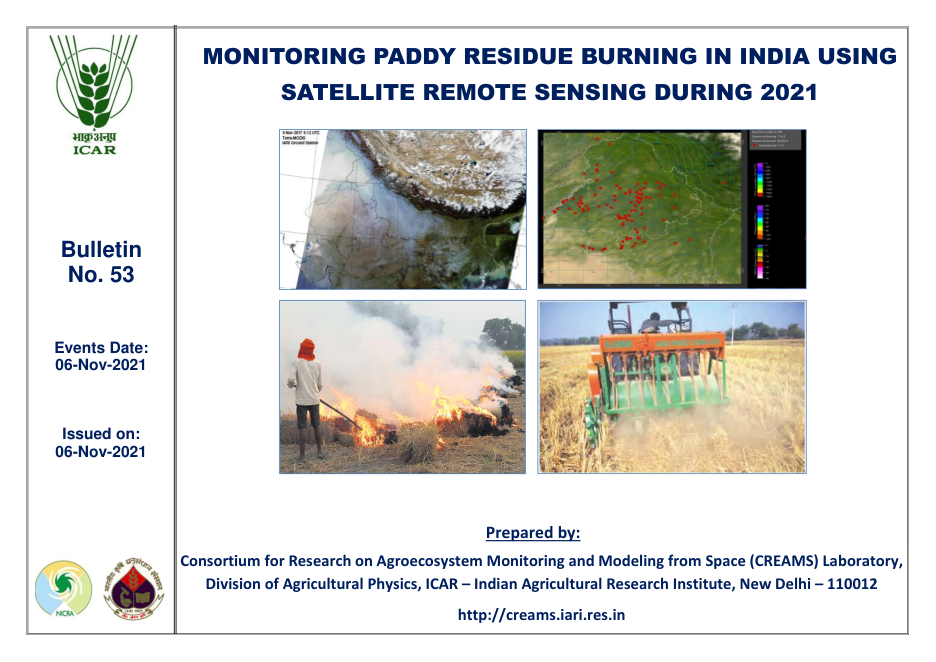
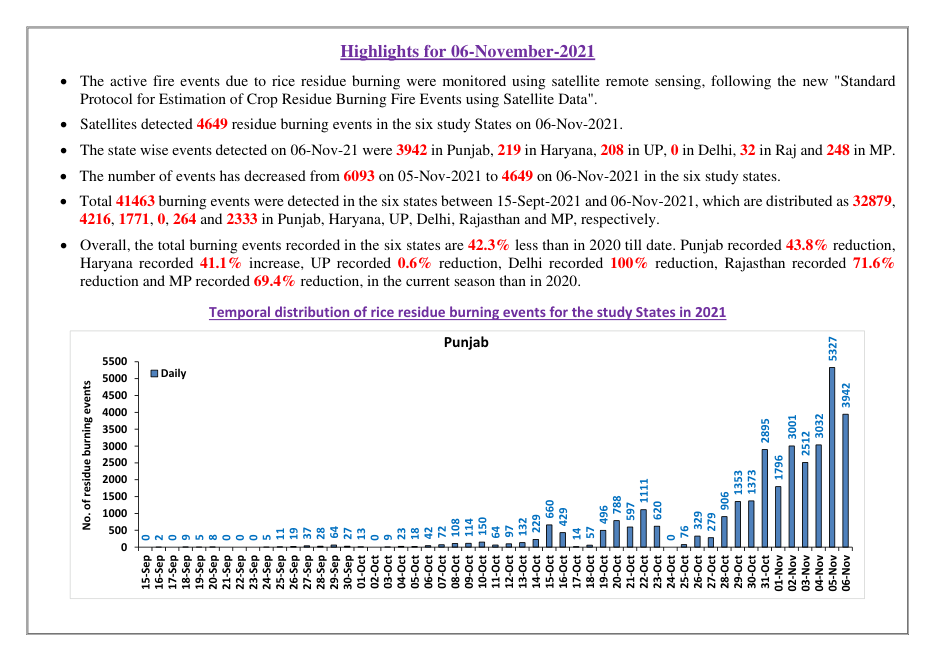
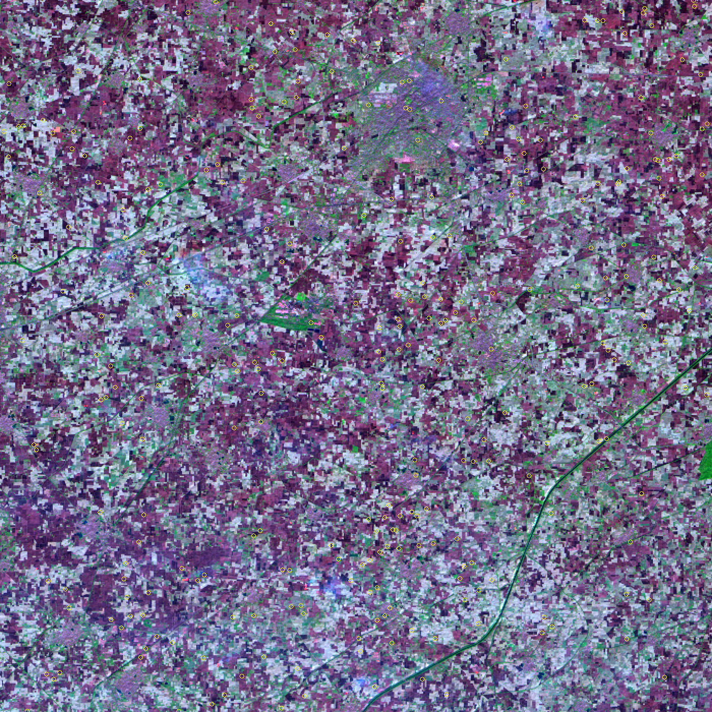
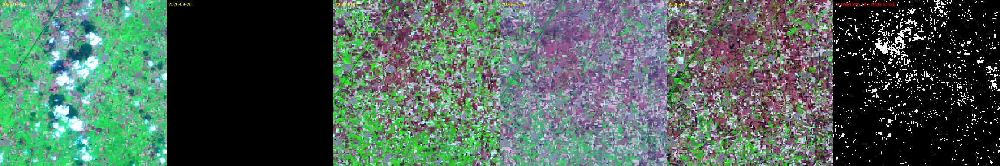
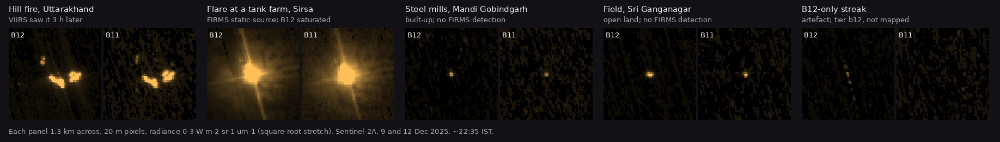
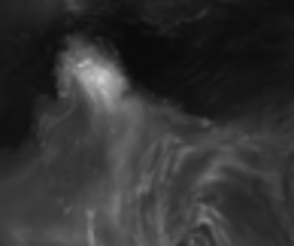

# How the data was made

Every number in this repository comes from a public source and a script in [`scripts/`](../scripts/). This page
explains, source by source, what was taken, how it was processed, how it was checked, and what it cannot tell you.

- [1. Fire detections (NASA FIRMS)](#1-fire-detections-nasa-firms)
- [2. Official counts (ICAR-IARI CREAMS bulletins)](#2-official-counts-icar-iari-creams-bulletins)
- [3. Burned area (NASA MODIS MCD64A1), and a Sentinel-2 method that failed](#3-burned-area)
  - [3c. Sentinel-2A at night: hot spots, not a crop-fire count](#3c-sentinel-2a-at-night-december-2025-hot-spots-not-a-crop-fire-count)
- [4. Smoke (NASA GMAO GEOS-FP)](#4-smoke-nasa-gmao-geos-fp)
- [5. Air quality and the stubble share](#5-air-quality-and-the-stubble-share)
- [6. Paddy area](#6-paddy-area)
- [7. Enforcement and residue management](#7-enforcement-and-residue-management)
- [8. Boundaries and the map](#8-boundaries-and-the-map)

---

## 1. Fire detections (NASA FIRMS)

**What it is.** NASA's Fire Information for Resource Management System lists every pixel in which a polar-orbiting
satellite saw an active fire: MODIS on Terra (≈10:30 IST pass) and Aqua (≈13:30) at 1 km since 2000, and VIIRS on
S-NPP (2012+), NOAA-20 (2018+) and NOAA-21 (2023+) at 375 m, which also have a night pass near 01:30 IST.
Each detection carries a time, a fire radiative power (FRP, in MW) and a confidence.

**How it was taken** (`scripts/firms_archive.sh`, `scripts/firms_fetch.py`)
- 2003-2025: NASA's public yearly country files for India and Pakistan (no key). The server limits each connection to
  about 110 KB/s, so the 90 files are fetched 12 at a time.
- The current year: the FIRMS area API for 68.5-89 E, 21-35.5 N in 5-day chunks, standard-processing data up to
  June and near-real-time data after. Near-real-time chunks are re-fetched for three days because NASA keeps filling
  them in; empty chunks (a feed outage) are retried on every run.
- NOAA-21 is not in the yearly files, so 2023-2025 NOAA-21 comes from the API.

**How it was processed** (`scripts/build_fires.py`)
- Clip to the study box. Drop FIRMS type 2 (static land sources such as refineries and kilns) and type 3 (offshore).
  Near-real-time rows have no type, so any 1 km cell the archive ever flagged as static is dropped from them too.
- Once a year's yearly file exists, API rows for that year are ignored (except NOAA-21) so nothing is counted twice.
- Assign each detection a district by looking it up in a 0.01° raster of the district polygons.
- **Detections are never merged across satellites.** One burning field can appear five times. Year-on-year
  comparisons use one sensor family: MODIS Terra + Aqua (2003 onward) or VIIRS S-NPP (2012 onward).

**Checked by:** the exported tables reconcile cell by cell (year × sensor × state × day) with the dashboard's
summary, 10,551,119 detections in all. Punjab season totals agree with published FIRMS-based studies.

**Limits.** A detection is a fire burning at overpass time. Fires lit between passes, short fires, fires under thick
smoke or cloud, and very small fires are missed. Hot desert surfaces in west Rajasthan occasionally produce daytime
VIIRS false alarms (e.g. 313 NOAA-20 points near Bikaner on 14 Oct 2026, seen by no other satellite).

*The overpass schedule shapes what is seen. The "night pass share" (detections on the 01:30 IST VIIRS pass) rose from
1.8% in 2012 to 8.7% in 2025, while the Aqua (13:30) to Terra (10:30) ratio climbed: burning has shifted later in the
day, between the passes.*

---

## 2. Official counts (ICAR-IARI CREAMS bulletins)

**What it is.** The Consortium for Research on Agroecosystem Monitoring and Modeling from Space (CREAMS) at the
Indian Agricultural Research Institute publishes a bulletin every day of the paddy (15 Sep - 30 Nov) and wheat
(Apr - May) burning seasons. These are the figures the government quotes.

**How it was taken** (`scripts/creams_scrape.py`). The crop-residue page links the current bulletins; older seasons
(rice 2018-2026, wheat 2022-2026 and special reports) sit in an open directory listing. All 851 PDFs are downloaded at
one request per second and cached.

**How it was processed.** Each PDF's text layer is parsed (pdfplumber / PyMuPDF), not OCR'd:
- the *Highlights* sentences: "Total 41463 burning events ... 32879, 4216 ... in Punjab, Haryana ...";
- state day-wise tables and the chart data labels;
- district tables with daily and cumulative counts;
- multi-year comparison tables (the same date in earlier seasons), which give 2016-2019 values;
- the annexure listing every event with its district, tehsil, latitude, longitude, satellite and time: 698,696 events.

**Checked by** `data/creams/creams_validation.json`, written by the parser: cumulative series must not decrease;
day counts must equal differences of cumulative counts; district rows must sum to state totals; table totals must
match the highlights sentence; event-list counts must match the day's total. Mismatches are listed, not hidden.
Season totals match CREAMS's published figures (Punjab: 71,304 in 2021, 36,663 in 2023, 10,909 in 2024, 5,114 in 2025).

**Limits.** CREAMS uses its own protocol (VIIRS-based, counting from 15 September; from 1 October before 2020), so its
numbers are lower than raw FIRMS. Some bulletins re-publish revised figures; the latest is used.

---

## 3. Burned area

### 3a. NASA MODIS MCD64A1 (used)

**What it is.** MCD64A1 collection 6.1 maps, for every 500 m pixel and month, the day of the year it burned, using
the drop in surface reflectance plus active-fire evidence. Unlike fire counts it does not depend on whether a
satellite passed while the fire was burning: it maps the scar.

**How it was taken and processed** (`scripts/burnscar.py`). The monthly `Burn_Date` cloud-optimised GeoTIFFs for
September to December are read from Microsoft Planetary Computer (keyless), warped to UTM 43N, and the first burn
between 15 Sep and 5 Dec is kept. District and state hectares come from rasterised district polygons; each pixel is
21.5 ha. Tiles coloured by burn date are cut for the map.

**Checked by.** District sums agree with state sums to within 0.02%. In the peak years 53% (2021) to 59% (2016) of
VIIRS S-NPP detections, and 57-61% of MODIS detections, fall on a mapped burned pixel; in 2024 only 22% of VIIRS
detections did, as burning thinned into scattered small fields the 500 m product misses. Punjab's 2016 total (1.89 million ha, 65% of the rice area) is in the range
of published estimates.

**Limits.** At 500 m, single 1-2 ha fields and short burns are often missed, so the hectares are a lower bound.
Planetary Computer is missing September 2023 and September-October 2025: those seasons are flagged incomplete and
left out of ratios. NASA publishes each month about two months later.

### 3b. A Sentinel-2 field-scale classifier (tested and rejected)

The goal was field-scale burn scars from Sentinel-2 (20 m bands, 2-5 day revisit). The pipeline was built: every
clear pass from September to December, cloud and shadow masks buffered by 120 m, a burn date per pixel.
The rule tested was the textbook one: fresh ash is dark in the near infrared (B8A < 0.19) and has a negative
normalised burn ratio (NBR = (B8A - B12) / (B8A + B12) < -0.05), confirmed by a second pass within 12 days.

*Central Punjab, 8 November 2021, in short-wave infrared false colour. Dark maroon fields are harvested paddy, burned
or not; yellow circles are VIIRS fire detections from the previous ten days.*

It failed validation, so it was not published:
- At VIIRS fire locations, "ash-like" pixels were only 1.5 to 2 times as common as in random harvested fields.
- On the same tile and calendar window, the full-season run rated **2025** (a year with about a tenth of the fires)
  at **77%** of paddy burned and **2021** (a peak year) at **1.2%**: the reverse of reality.

*Freshly cut, damp paddy stubble is as dark in the near infrared and as low in NBR as ash, and stays that way for
weeks. A spectral threshold cannot separate burned from merely harvested fields in this landscape; doing so needs a
classifier trained on fields known to have burned (for example from high-resolution imagery or field surveys).*

### 3c. Sentinel-2A at night (December 2025): hot spots, not a crop-fire count

**What it is.** From 3 to 22 December 2025 ESA left Sentinel-2A's camera on during its night (ascending) pass as a
test, and released the images in June 2026 (Copernicus Data Space collection `sentinel-2-night-time-acquisitions`;
processing note [doi:10.5281/zenodo.20286476](https://doi.org/10.5281/zenodo.20286476)). Two scenes cover Punjab:
9 Dec at 22:32 IST (east Punjab, Haryana, the Himachal and Uttarakhand hills) and 12 Dec at 22:42 IST (west Punjab
and Pakistani Punjab). With no sunlight, a pixel that is bright in the short-wave infrared is giving off heat. At
20 m that is a far smaller footprint than MODIS (1 km) or VIIRS (375 m).

**How it was taken and processed** (`scripts/s2night.py`).
- The orthorectified products (one float32 radiance GeoTIFF per band, about 2.7 GB per scene) are read from the CDSE
  S3 store; only B04, B08 (10 m), B11 and B12 (20 m) are kept.
- The data are coarse at night. Radiance comes in steps of 0.0094 (B12) and 0.028 (B11) W m⁻² sr⁻¹ µm⁻¹ per count,
  most pixels read exactly zero, and the noise arrives as clumped spikes of up to about 0.94 in B12.
- Each pixel's excess over the median of its 1 km block is computed. Pixels with a B12 excess of at least 0.15 are
  joined into clusters, which is about twice the night SWIR noise limit reported by DLR.
- A cluster is kept when its B12 peak and the B11 value next to it are both at least 0.5. B11 and B12 are separate
  detector rows read about 0.6 s apart, so a noise spike in one band does not appear in the other.
- A second tier keeps clusters with B12 alone at 1.0 or more. It is exported but not mapped.

**Checked by.**
- *Mirror test.* The same rules were run on the negated images, where every cluster is noise by construction. About
  3,700 negated candidates per scene gave **0** selected clusters in either tier, on either night.
  - The negative side bottoms out at −0.94 in B12, the zero-count floor, so the test cannot rule out positive-only
    artefacts above that level.
  - Image chips show that some B12-only clusters are dotted streaks. That is why only the two-band tier is mapped.
- *NASA FIRMS, 9 Dec.* The two-band hot spots recovered **32 of 34** VIIRS night detections made about three hours
  later (within 1 km), and the one Terra night detection.
  - All 32 matches were forest and scrub fires in Himachal and Uttarakhand.
  - The **2** VIIRS night detections in the Punjab-Haryana plains were **not** seen.
  - 36% of hot spots had a FIRMS detection within 1 km in the four days either side, against 3% for the same points
    moved 5-30 km at random.
- *NASA FIRMS, 12 Dec.* The 4 VIIRS night detections in the scene were all one static industrial site, which was matched.
- *Setting.*
  - A hot spot is labelled industrial when FIRMS lists a static source (VIIRS type 2, 2012-2025) within 1 km.
  - It is labelled built-up when ESA WorldCover 2021 maps at least a quarter of the 310 m box around it as built.
  - Everything else is labelled open.
  - Esri imagery of all 61 plains hot spots agreed: about half sit on factories, steel mills (Mandi Gobindgarh),
    industrial estates (Ludhiana, Mohali, Lahore) or a flare; the rest are in fields.

*Hot spots from the two night scenes, in B12 and B11. Real heat sources appear in both bands; the streak on the
right appears in B12 alone and is a sensor artefact.*

**Result.** 111 two-band hot spots: 83 on open land, 19 built-up, 9 known industrial. Sentinel-2 at night reliably
sees heat sources as small as a few hundred square metres. It does not reliably separate crop fires from furnaces
and kilns. In the plains on these two nights there was no independent detection to confirm any hot spot as a crop
fire. The map shows them as "night hot spots" (layer off by default), coloured by setting, and they are never added
to fire counts.

**Limits.**
- Two December nights, after the paddy season, say nothing about October-November.
- Open-land hot spots can still be lone factories or brick kilns, which WorldCover does not map as built-up.
- Geolocation uses no ground control, so expect offsets of tens of metres.
- The fitted temperature and radiative power (B11/B12 ratio) are indicative only.
- Night lights could not be mapped: detector striping in the visible and near-infrared bands (0.01-0.03) is larger
  than the city signal, even after destriping.
- ESA's second night campaign (23 Jul-1 Sep 2026) is restricted to expert users, and no campaign announced by
  October 2026 covers the October-November burning season.

---

## 4. Smoke (NASA GMAO GEOS-FP)

**What it is.** GEOS-FP is NASA's operational atmospheric model. It assimilates satellite aerosol observations and
uses fire emissions (QFED) to simulate aerosol optical depth (AOD) by species. Organic carbon, black carbon and brown
carbon together are the smoke-dominated part, the NASA counterpart of the Copernicus CAMS "organic matter AOD" field.

**How it was taken** (`scripts/fetch_smoke.py`). From the NCCS OPeNDAP server (keyless): `tavg3_2d_aer_Nx` 3-hourly
OC, BC, BrC and total extinction AOD at 550 nm, and `tavg1_2d_slv_Nx` 10 m wind, over 64-94 E, 18-38 N at
0.3125° × 0.25°, from 15 September through the forecast. Each "seamless" run is analysis followed by forecast; the
recent run with the longest forecast (00Z, about 10 days) is used.

**How it was processed.** The server sometimes truncates a response, returns a chunk of zeros, or pads the forecast
tail with 1e15 fill values. Short chunks are retried and never silently joined; empty frames are filled from a
neighbouring run; fill values are dropped; nothing is interpolated except where flagged. Frames are packed into PNG
atlases (AOD stored as √(AOD/2) for precision at low values); the browser upsamples them with a bicubic B-spline,
interpolates between 3-hourly frames and re-projects to Web Mercator on the GPU.

**Limits.** OC includes non-fire sources (vehicles, cooking, industry), so the field is "carbonaceous aerosol",
dominated but not defined by stubble smoke. The model's surface PM2.5 is biased low against ground monitors.
GEOS-FP keeps its seamless archive back to February 2026 only.

---

## 5. Air quality and the stubble share

**CPCB ground PM2.5** (`scripts/build_aq_ground.py`). The Central Pollution Control Board's continuous stations,
read through the OpenAQ v3 API. One physical station often has several OpenAQ ids over the years; these are merged by
site. A day is kept only if it has at least 75% of the sensor's usual record count spanning 17+ hours; values ≤ 0 or
> 1,500 µg/m³ are dropped. The city value is the mean of stations reporting that day (Delhi grew from 6 stations in
2016 to about 40). OpenAQ holds no CPCB data from late 2022 to February 2025.

**Model PM2.5 and weather** (`scripts/build_db_extras.py`). Open-Meteo's CAMS air-quality archive (from August 2022)
and ERA5 reanalysis (2003 onward) for seven receptor cities: daily wind, direction, temperature, rain and the
boundary-layer height at 14:00 IST, which sets how much smoke stays near the ground.

**Stubble share of Delhi PM2.5.** Two IITM Pune products publish how much of Delhi's PM2.5 their models attribute to
stubble burning. The Decision Support System's daily values (2023 onward) are read from the chart data embedded in the
live page and in 42 Wayback Machine captures; SAFAR's bulletin figures (2019-2022) are transcribed from archived
homepage captures, each with its verbatim quote and the capture URL. They are different models and are not joined.

---

## 6. Paddy area

District kharif rice area and production (1997-2025) from the Directorate of Economics and Statistics / UPAg, as
compiled in the [Agri at Source](https://agri.reclaimchennai.city/) catalogue (`scripts/build_db_extras.py`).
All 267 district names were matched to the district map: by name (240), by LGD code history (6), by known renames
such as Ferozepur → Firozpur (13), and new districts carved out after 2021 counted with their parent (8). Year keys
are the agricultural year's start, so kharif rice of year *Y* is the straw burned in season *Y*.

---

## 7. Enforcement and residue management

`scripts/build_enforcement.py` assembles, from Punjab Pollution Control Board action-taken reports to CAQM, Haryana's
enforcement dashboard, CAQM directions and press releases, NGT affidavits and Lok Sabha / Rajya Sabha answers (some
through the data.gov.in API):
- fire events, inspections, burning confirmed, environmental compensation (cases, imposed, recovered), FIRs, red
  entries in land records, action against officials;
- CRM scheme machines, custom hiring centres and funds, residue used in and out of the field;
- a dated timeline of court orders, CAQM directions, incentives and rule changes.

Every value records its source document, the as-of date and whether the figure is cumulative. Figures quoted from
prose are checked against the cached document text; values read off scanned tables are flagged and must add up to
the printed totals. Where several reports cover a season, the latest is marked. A 2022 compensation table whose unit
makes it ten times every other year is flagged and not plotted. Spot-checked: Punjab's 2025 season-end totals
(₹1,25,85,000 compensation, 1,963 FIRs, 2,176 red entries) match the PPCB report of 30.11.2025.

---

## 8. Boundaries and the map

Country outlines are Natural Earth 1:10m from India's point of view; states and districts are geoBoundaries (India
districts from the Local Government Directory, 2021). The map is MapLibre GL (globe, 3D terrain with AWS Terrain
Tiles, elevation tinting), D3 for the side charts and ECharts for the analysis page, with Esri basemaps loaded at
view time and not redistributed.

## 9. North to south: trajectories, Chennai's air and cyclones

**Question.** Does smoke from crop fires in Punjab, Haryana and Delhi reach Chennai, about 2,000 km away, and what do
Bay of Bengal cyclones do to the city's air?

**Extent.** From October 2026 the fire layer covers 66-98 E, 6-37.5 N (India and Pakistan country files; API rows
outside India/Pakistan districts are dropped so the current year matches the archive) and the GEOS-FP smoke field
62-100 E, 4-38 N. District ids 0-528 are unchanged; the 328 new districts follow them.

**Winds and trajectories** (`scripts/transport.py`). NASA GMAO GEOS-FP assimilation, `tavg1_2d_slv_Nx` U850/V850,
hourly means sampled every 3 h on a 0.625 x 0.5 degree grid over 60-100 E, 0-40 N, 15 September - 31 December of each
year from 2018 (the collection starts December 2017). Over the Tibetan plateau 850 hPa is below ground; those cells
are masked and a trajectory that reaches them stops. For each receptor and day, four parcels arrive at 00, 06, 12 and
18 UTC and are integrated 120 h backward with a second-order Runge-Kutta (Heun) scheme and a 15-minute step, with
bilinear interpolation in space and linear in time. The trajectories are two-dimensional and isobaric: no vertical
motion, turbulent mixing, rain-out or chemistry.

**Fires met.** VIIRS S-NPP vegetation-fire detections (FIRMS type 0) are counted per day on a 0.5 degree grid. At every
hourly trajectory point the detections in the cell under it, on that day and the day before, are summed: `fire_all`.
`fire_nw` is the same sum restricted to the Punjab-Haryana-Delhi box (73.5-78.5 E, 27.5-32.5 N). Hours over the
Indo-Gangetic Plain box (74-88 E, 24-31 N) and over the sea (a coastline approximation) are also recorded. Values are
averaged over the day's four trajectories.

**Day classes.** *NW fires*: `fire_nw` >= 1. *Gangetic plain*: >= 6 h over the plain, no live NW fires. *Sea*: >= 60% of
the 121 hourly points over the sea. *Peninsula*: the rest.

**Air quality** (`scripts/build_aq_south.py`). CPCB/TNPCB continuous monitors via OpenAQ v3: daily city means of
stations within 35 km, with the QA rules of section 5 plus a flat-line test (a sensor repeating one value all day is
dropped; 2,705 PM2.5 sensor-days). OpenAQ holds no CPCB data from November 2022 to February 2025; CAMS (via Open-Meteo,
from August 2022) fills those seasons but reads Chennai's PM2.5 at about half the monitors. In `build_south.py` a
city-day reported by two or fewer stations is dropped when PM2.5 > 3 x CAMS + 50 (one day: Chennai 4 Dec 2025,
324 µg/m³ the day after 142 mm of rain). The hourly Chennai panel adds the TNPCB/CPCB values collected by
pol.reclaimchennai.city. These are AQI sub-indices of 24 h (PM, NO2) and 8 h (CO) running means, converted back with
CPCB breakpoints; after conversion they match OpenAQ's own 24 h means (r = 0.90). It also adds the aqi.in low-cost
network, which reads about 1.24 x the reference monitors and is shown but not redistributed.

**Effect estimate** (`scripts/build_south.py`). Ordinary least squares on daily values, October-December, days with a
cyclone within 800 km left out: log(PM2.5) on log(1 + `fire_nw`), log(1 + other fires), the share of hours over the
sea, log(1 + rain), 10 m wind speed, log boundary-layer height and month dummies, with HC1 robust standard errors.
The reported effect is the change for a tenfold rise in (1 + fires met), 10^b - 1. Days are serially correlated, so
the intervals are, if anything, too narrow. The comparison is observational: air from the north-west is also drier
and slower, and it passes over the cities and industry of the plain and the east coast.

**Cyclones** (`scripts/build_cyclones.py`). IBTrACS v04r01 North Indian basin (IMD best track) for 2003-2025.
The current storm comes from IMD RSMC New Delhi Tropical Weather Outlooks and Tropical Cyclone Advisories (observed
positions with the bulletin URL and issue time; forecasts kept apart), with JTWC and GDACS fixes as a cross-check.
The closest approach to Chennai is measured to the track line. For the composite, each storm within 800 km since 2016
contributes Chennai's daily PM2.5 for days -7 to +7 from the closest approach. Values are divided by the storm's own
mean over days -7 to -3, using ground data where at least three of those days exist and CAMS otherwise. Medians and
quartiles are taken across storms, split by whether the storm passed north or south of the city.

**Results (2018-2026).**
- **How often:** Chennai's air met north-western fires on 10.5% of October-November days.
- **Fire effect:** a tenfold rise in fires met goes with +25% PM2.5 (95% interval +9 to +43%). That is about 3% of the
  season's PM2.5, and a median of 31% on the days the smoke arrives.
- **Air-mass origin:** on dry October days the median PM2.5 was 49 µg/m³ (NW fires), 51 (plain, no fires) and 24 (sea).
- **Cyclones:** PM2.5 ran about 23% higher for days after storms that passed north of Chennai and about 35% lower after
  those that passed south.
- **Arnab (Oct 2026):** Chennai's sensors went from a median 20 to a peak of 151 µg/m³ on 26-27 October, while the air
  came down the east coast from the Gangetic plain.

## 10. A field-scale burnt-area method from CEEW (tested and rejected)

CEEW's October 2026 issue brief "Beyond Single Sources" fills Sentinel-2's revisit gaps with commercial PlanetScope
imagery to count newly burnt fields. It was reproduced over its own study area with free HLS/Landsat imagery
filling the gaps. The burnt-pixel rule (BAIS2 >= 0.78 and Tasseled Cap brightness <= 0.34) flagged 77% of cropland
in 2025 and 74% in 2021, while VIIRS counted 177 and 3,450 fires over the same area. A same-morning Landsat
placebo found as many "new" fields as the real gap-fill. The rule cannot tell burnt from harvested paddy, the
failure that also sank the classifier in section 3b, so it is not used. Details:
[`burnfield_pilot.md`](burnfield_pilot.md).
